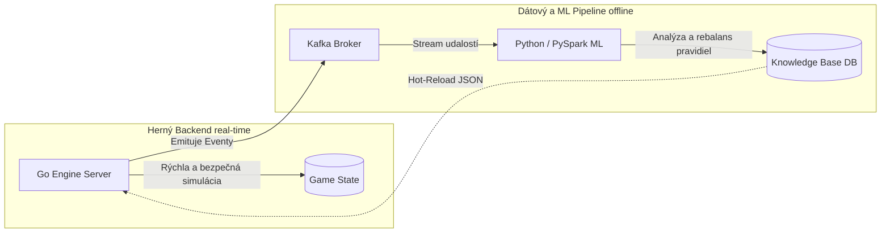

# Hĺbková štúdia: Porovnanie Go, Python a Cython pre backend Sovereign Engine

Tento dokument predstavuje výskumnú štúdiu (Deep Research) porovnávajúcu tri programovacie jazyky – **Go (Golang)**, **Python** a **Cython** – z hľadiska ich vhodnosti na implementáciu backendových abstraktov projektu **dusan-game** (fyzikálna simulácia Ohmovho zákona, stateless state pipeline, Big Data telemetria a dynamická znalostná báza).

---

## 📊 Súhrnná porovnávacia matica

| Kritérium | Go (Golang) | Python | Cython |
| :--- | :--- | :--- | :--- |
| **Výkon a Rýchlosť** | Vysoký (blízko C) | Nízky (interpretrovaný) | Vysoký (C-extensions) |
| **Výpočtová Bezpečnosť** | Absolútna (typovo bezpečný garbage collector) | Vysoká (GC, dynamické typy) | Nízka (možnosť UB a pádov ako v C) |
| **Paralelizmus & Concurrency** | Vynikajúci (Goroutines & Channels) | Obmedzený (GIL prekážka) | Stredný (možnosť `with nogil`) |
| **Dynamický Rule Loading** | Stredný (vyžaduje parser) | Vynikajúci (eval/exec, dynamic import) | Nízky (nutnosť kompilácie) |
| **Integrácia na Big Data / ML** | Dobrá (ClickHouse, Kafka API) | Absolútna špička (Spark, TensorFlow) | Stredná (cez Python wrapper) |
| **Zložitosť nasadenia (Build)** | Veľmi jednoduchá (1 statický binár) | Veľmi jednoduchá (skript) | Vysoká (nutnosť GCC, Setup.py) |

---

## 1. Go (Golang) – Výkonný a typovo bezpečný konkurent

Go sa javí ako mimoriadne silný kandidát na herný backend vďaka natívnej podpore concurrency a vysokej rýchlosti.

### Výhody pre Sovereign Engine:
1.  **Bezpečné paralelné spracovanie (Concurrency):**
    Ak na hernom serveri prebiehajú stovky zápasov súčasne, *Goroutines* umožňujú alokovať jedno odľahčené vlákno na každý zápas s minimálnou pamäťovou réžiou (cca 2 KB na goroutinu).
2.  **Prevencia nízkoúrovňových chýb:**
    Go nepovoľuje aritmetiku ukazovateľov (pointer arithmetic) v bezpečnom režime. Nedochádza k chybám pretečenia buffra (Buffer Overflow) ani k zlyhaniam segmentácie (Segmentation Faults). Matematické prepočty Ohmovho zákona sú chránené silným statickým typovaním.
3.  **Bezstavové (Stateless) modelovanie:**
    Go štruktúry (`struct`) a absencia tried s dedičnosťou podporujú kompozičný a funkcionálny prístup. Funkcia prechodu stavu `ResolveEngineState(state GameState) GameState` je v Go ľahko čitateľná a vysoko optimalizovaná kompilátorom.

### Nevýhody:
*   Menej flexibilné zaobchádzanie s dynamickými pravidlami kariet. Načítanie nových pravidiel za behu vyžaduje napísanie JSON parsera/interpretéra pravidiel, keďže Go je staticky kompilovaný jazyk.

---

## 2. Python – Flexibilita a Big Data kráľ

Python je najpoužívanejší jazyk pre Big Data a AI, no jeho runtime (CPython) má limity.

### Výhody pre Sovereign Engine:
1.  **Dynamický Rule Engine (Znalostná báza):**
    Keďže herné karty a ich inštrukcie sa často menia (balans hry), Python umožňuje dynamicky načítavať a spúšťať nové pravidlá bez nutnosti reštartovania servera. Preklady a herné mechaniky môžu byť definované ako dynamické skripty.
2.  **Direct Ingestion do Big Data:**
    Udalosti generované herným enginom (napr. `PlayerMovedEvent`) sa dajú priamo spracovávať pomocou PySpark, Pandas alebo ukladať do analytických nástrojov s natívnym Python API.

### Nevýhody:
*   **Slabý výkon a GIL:**
    Global Interpreter Lock (GIL) zabraňuje CPythonu vykonávať skutočný multithreading na viacerých jadrách CPU. Pri zložitých výpočtoch reakčných reťazcov v Ohmovom zákone by mohol server rýchlo naraziť na výkonnostný strop.
*   **Dynamické typovanie:**
    Absencia striktnej typovej kontroly na runtime zvyšuje riziko chýb (napr. odovzdanie nesprávneho typu premennej do matematických funkcií).

---

## 3. Cython – Rýchlosť C s príchuťou Pythonu

Cython prekladá kód podobný Pythonu do C/C++ a následne ho kompiluje na zdieľané knižnice (`.so` / `.pyd`).

### Výhody pre Sovereign Engine:
1.  **Obídenie GIL a maximálny výkon:**
    V Cythone je možné explicitne uvoľniť GIL pomocou bloku `with nogil`. Matematické slučky pre vyhodnocovanie reakcií v grafe tak môžu bežať paralelným C-výkonom.
2.  **Statické typovanie premenných:**
    Deklarácia premenných pomocou `cdef int` alebo `cdef float` prináša dramatické zrýchlenie aritmetických operácií.

### Nevýhody a riziká ("Surové C"):
*   **Návrat k rizikám jazyka C (Unsafe Operations):**
    Cython odstraňuje bezpečnostné siete Pythonu. Ak použijete čisté C-typy a dôjde k deleniu nulou, pretečeniu pamäte alebo prístupu k neplatnému ukazovateľu, **celý server spadne s chybou `Segmentation Fault` (zlyhanie segmentácie)**, na rozdiel od Pythonu, ktorý vyhodí zachytiteľnú výnimku `ZeroDivisionError`.
*   **Build a nasadenie:**
    Cython vyžaduje kompilátor (GCC/Clang) a Setup.py. Každá zmena vyžaduje re-kompiláciu. Nasadenie v dockeri je zložitejšie, pretože balíčky sú závislé od architektúry operačného systému (OS-specific binary wheels).

---

## 🏆 Architektonické odporúčanie

Pre unifikované a udržateľné riešenie odporúčam **hybridný dvojvrstvový prístup (Split-Architecture Pattern)**:

1.  **Herná simulácia (Zápasy v reálnom čase): Použiť GO**
    *   *Prečo:* Go poskytuje C-like výkon, ale s **absolútnou pamäťovou a typovou bezpečnosťou** (žiadna hrozba Segmentation Faults alebo UB). Vynikajúco zvláda tisíce paralelných WebSocket spojení vďaka goroutinám a zaručuje, že neošetrené aritmetické výpočty nezhodia celý server.
2.  **Telemetria, ML a Big Data (Offline vrstva): Použiť PYTHON**
    *   *Prečo:* Python dominuje v spracovaní dát. PySpark a ClickHouse konektory umožnia pohodlne mapovať pohyby na políčkach a analyzovať hotspoty.
3.  **Cythonu sa vyhnúť:**
    *   *Prečo:* Pre real-time engine prináša príliš veľa build zhluku, zťažuje hot-reload a hlavne **vracia do hry nízkoúrovňové unsafe riziká surového C**, ktorým sa chceme vyhnúť.
