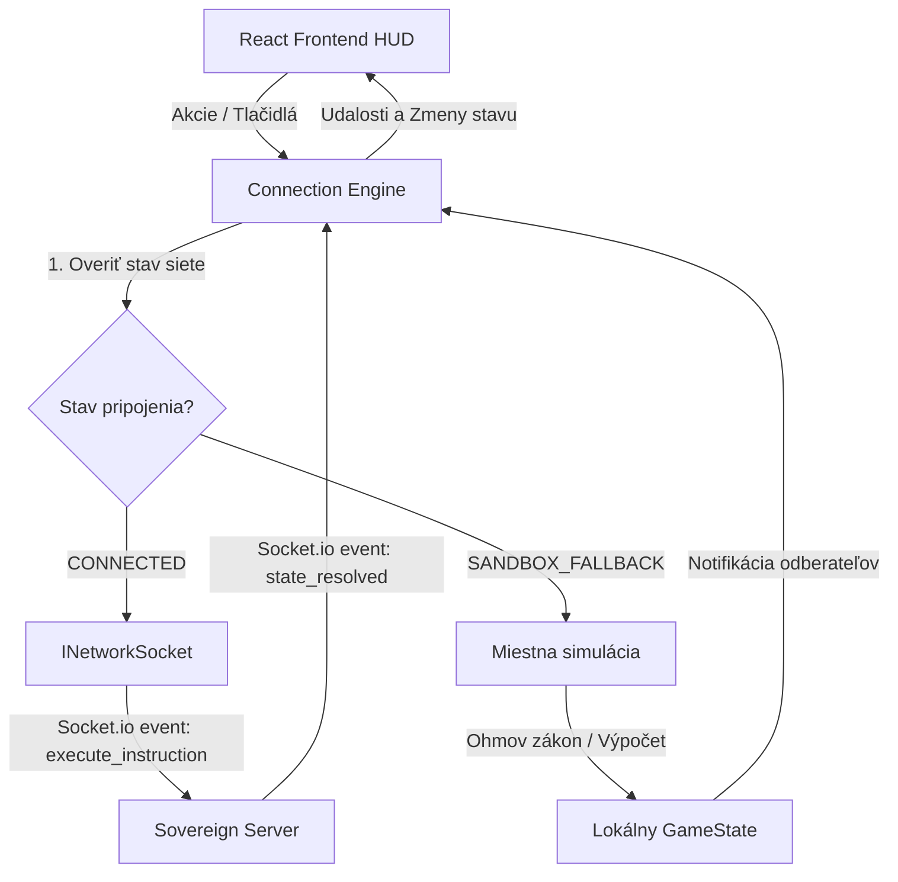

# Architektúra: Sieťový a Operačný Engine (Connection Engine Blueprint)

Tento dokument popisuje návrh a vnútornú logiku komponentu **Connection Engine** (`ConnectionEngine.ts`), ktorý zabezpečuje načítavanie závislostí a synchronizáciu stavu (operation logic) medzi klientskym frontendom a backendom.

---

## 1. Architektonické komponenty

Engine je navrhnutý ako **dekoplovaný (decoupled) manažér sieťových a lokálnych udalostí**, čím sa predchádza výpadkom pri strate pripojenia.



### A. Abstrakcia transportu (`INetworkSocket`)
Aby zdieľaný balíček nebol závislý od knižnice `socket.io-client` v runtime, Connection Engine komunikuje cez tenké rozhranie:
```typescript
export interface INetworkSocket {
  on(event: string, callback: (...args: any[]) => void): void;
  off(event: string, callback?: (...args: any[]) => void): void;
  emit(event: string, ...args: any[]): void;
  connected: boolean;
}
```
*Vďaka tomu je možné pod kapotou použiť Socket.io, natívne WebSockety, alebo dokonca gRPC / HTTP polling.*

### B. Načítavanie a kešovanie závislostí (Fetch & Cache)
Pred štartom hry je potrebné načítať popisy kariet a parametre frakcií. Connection Engine obsahuje vnútornú pamäť (Cache):
```typescript
public async fetchCardDependencies(heroId: string): Promise<any> {
  const cacheKey = `cards_${heroId}`;
  if (this.assetCache.has(cacheKey)) return this.assetCache.get(cacheKey);
  // Fetch a následné uloženie do Cache...
}
```

### C. Riešenie výpadkov (Automatic Sandbox Failover)
Ak server neodpovedá alebo spojenie spadne, Engine okamžite zmení stav na `SANDBOX_FALLBACK` a inicializuje lokálny stav hry. Hráč tak nepocíti prerušenie hry a môže pokračovať v offline režime, kde sa akcie vyhodnocujú deterministickým lokálnym výpočtom prúdu $I=V/R$.

---

## 2. Dátový a Telemetrický logovací systém

Engine spravuje zoznam telemetrických udalostí (`TelemetryEvent`), ktoré sú spätne distribuované do klientskeho UI pre zobrazenie v reálnom čase:

```typescript
export interface TelemetryEvent {
  timestamp: string;
  source: 'CLIENT' | 'SERVER' | 'SANDBOX';
  type: 'INFO' | 'ACTION' | 'ERROR' | 'PHYSICS';
  message: string;
}
```

Udalosti sú streamované cez **Observer Pattern**, na ktorý sa registruje UI panel:
```typescript
const unsubscribe = connectionEngine.subscribeToLogs((logEvent) => {
  setLogs(prev => [logEvent.message, ...prev]);
});
```

---

## 3. Príklad integrácie na klientovi (`App.jsx`)

```typescript
import { useEffect, useState } from 'react';
import { io } from 'socket.io-client';
import { ConnectionEngine } from '@dusan-game/shared';

const socket = io('http://localhost:3001');
const engine = new ConnectionEngine(true); // povolený fallback sandbox

export default function App() {
  const [gameState, setGameState] = useState(null);

  useEffect(() => {
    // Naviazanie socketu
    engine.bindSocket(socket);

    // Prihlásenie sa k odberu stavu
    const unsubscribeState = engine.subscribeToState((state) => {
      setGameState(state);
    });

    return () => {
      unsubscribeState();
    };
  }, []);

  const handlePlayCard = (cardId, targetHex) => {
    engine.executeInstruction({
      sourceId: 'thread_king_ai',
      targetId: 'thread_hacker_root',
      instructionId: cardId
    });
  };
}
```
