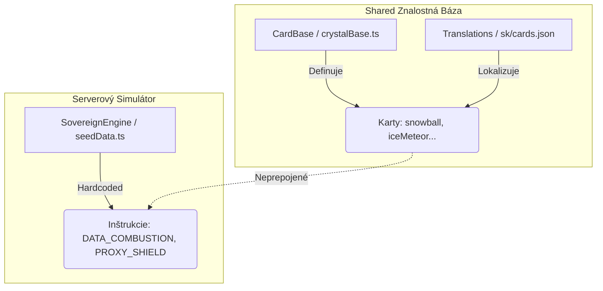
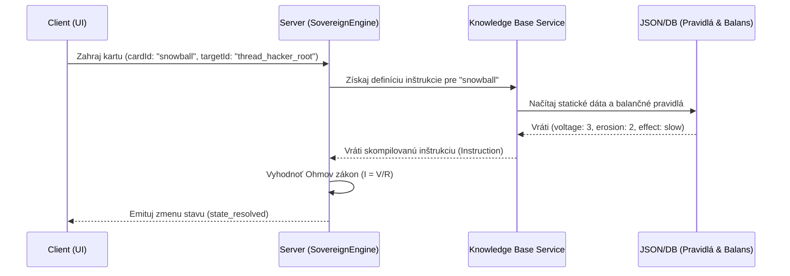
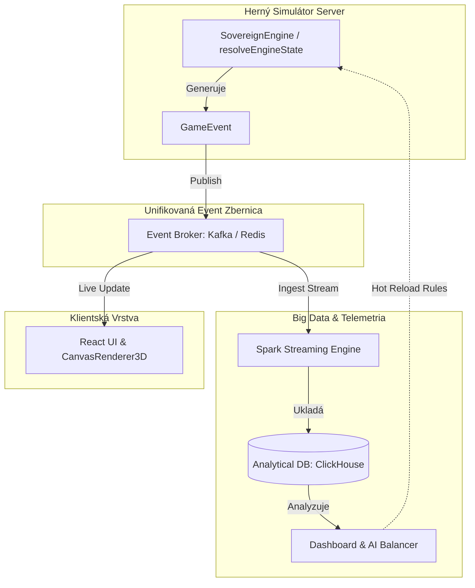

# Architektonická dokumentácia & Analýza zmien: Dušan Game (Sovereign Engine V2)

Tento dokument poskytuje prehľad o architektúre projektu **dusan-game**, analyzuje posledné zmeny v kóde a navrhuje riešenie pre integráciu a vylepšenie **knowledge base** (znalostnej bázy) s cieľom jej transformácie na produkčnú funkčnú architektúru serverovej aplikácie.

---

## 1. Prehľad architektúry a komponentov

Projekt je štruktúrovaný ako **monorepo** s tromi hlavnými balíkmi (`packages/*`):

### A. Shared (`packages/shared`)
Zodpovedá za zdieľané dátové typy a statické assety. Definuje základy dátových entít a prekladov:
*   **Typový systém (`src/core/types.ts`):** Definuje doménové rozhrania pre hrdinov (`Hero`), karty (`Card`), a pomocné typy (`HeroId`, `CardCategorization`, `CardSpecification`, `CardEffect`, `CardType`, `UnitType`).
*   **Statická znalostná báza (`src/data/base/`):** Obsahuje zdrojové dáta hrdinov a sady kariet pre jednotlivé frakcie (napr. `CRYSTAL_HERO_BASE` a `CRYSTAL_CARDS_BASE` v [crystalBase.ts](file:///home/rhoddos_berger/Documents/Github/dusan-game/packages/shared/src/data/base/crystalBase.ts)).
*   **Lokalizácie (`src/translations/`):** JSON preklady pre hrdinov a karty v češtine (`cs`) a slovenčine (`sk`) (napr. [cards.json pre sk](file:///home/rhoddos_berger/Documents/Github/dusan-game/packages/shared/src/translations/sk/cards.json)).

### B. Server (`packages/server`)
Implementuje backend a simuláciu fyziky spracovania inštrukcií na základe **Ohmovho zákona**:
*   **SovereignEngine (`src/models/SovereignEngine.ts`):** Riadi hernú slučku, spravuje zoznam aktívnych vlákien, udržiava informácie o celkovom teple systému (`systemHeat`), entropii (`globalEntropy`) a vyhodnocuje sieť akcií (`actionNetwork`).
*   **Thread (`src/models/Thread.ts`):** Predstavuje výpočtové vlákno (hráča alebo bota). Každé vlákno má atribút sémantickej integrity (`memoryIntegrity` - ekvivalent životov), základný odpor, dosah útokov/kúziel, hernú pozíciu (`{ meta: number, hex: number }`) a buffer kariet (ruku/balíček).
*   **Instruction (`src/models/Instruction.ts`):** Výpočtový ekvivalent herných kariet. Má fyzikálne parametre ako napätie (`voltage` - $V$), odpor (`resistance` - $R$) a sémantickú eróziu (`semanticErosion` - sila zásahu).
*   **ActionNode (`src/models/ActionNode.ts`):** Uzol v grafe reakcií. Umožňuje reťazenie reakcií a výpočet celkového odporu vetvy.
*   **Fyzikálna simulácia:** Výpočtové vyhodnotenie akcie sa riadi vzorcom prúdu podľa Ohmovho zákona:
    $$I = \frac{V}{R_{target} + R_{reactions}}$$
    *   Ak je výsledný prúd $I \ge 1$, akcia uspeje a zníži `memoryIntegrity` terča o hodnotu `semanticErosion`.
    *   Ak je $I < 1$, akcia zlyhá a prebytočný odpor sa transformuje na teplo systému (`systemHeat`). Pri `systemHeat > 100` nastáva **termodynamická očista** (`ThermodynamicPurge`), ktorá dealokuje najslabšie vlákno, čím ochladí systém.

### C. Client (`packages/client`)
Používateľské rozhranie napísané v React + Vite + TailwindCSS:
*   **3D WebGL render (`src/components/CanvasRenderer3D.jsx`):** Vizualizuje hernú arénu pomocou Three.js (`@react-three/fiber` a `@react-three/drei`). Aréna pozostáva z **9 metapozícií**, pričom každá obsahuje **7 hexagónov** (spolu 63 dlaždíc).
*   **Dynamický post-processing:** Shader efekty (Bloom, Chromatic Aberration, Glitch) sa škálujú dynamicky podľa úrovne `entropy` prijatej zo servera. Pri extrémnej entropii ($>75\%$) sa spúšťa vizuálny glitch.
*   **Rozhranie (`src/components/ArenaUIOverlay.jsx`):** Glassmorphism telemetry panel pre vizualizáciu entropie, stavu servera, zoznamu akcií a herných kariet.

---

## 2. Analýza posledných zmien v kóde

Na základe prešetrenia súborov boli v poslednej dobe vykonané nasledovné kľúčové vylepšenia:
1.  **Migrácia na 3D zobrazenie:** Pôvodný 2D PixiJS renderer ([CanvasRenderer.jsx](file:///home/rhoddos_berger/Documents/Github/dusan-game/packages/client/src/components/CanvasRenderer.jsx)) bol nahradený plnohodnotným 3D izometrickým prostredím v [CanvasRenderer3D.jsx](file:///home/rhoddos_berger/Documents/Github/dusan-game/packages/client/src/components/CanvasRenderer3D.jsx).
2.  **Modularizácia sub-hexov a makro-metapozícií:** Matematika výpočtu 3D súradníc v [HexMath3D.js](file:///home/rhoddos_berger/Documents/Github/dusan-game/packages/client/src/utils/HexMath3D.js) zabezpečuje, aby makro-sektory presne zapadali do seba a tvorili celistvý včelí plást s 9 sektormi.
3.  **Integrácia sémantického telemetrického HUD:** HUD v `ArenaUIOverlay.jsx` bol rozšírený o sledovanie stresu z entropie (`ENTROPY STRESS`) a logovanie reakčných reťazcov v reálnom čase zo socketov.

---

## 3. Identifikované spojitosti a rozdiely (Mismatch v Knowledge Base)

Pri analýze sme narazili na dôležitý **architektonický rozpor** medzi dvoma konceptmi v aplikácii:



1.  **Rozpor v dátovom modeli:**
    *   Statické definície kariet v `shared` (`CardBase`) používajú atribúty pre RPG/kartové hry (`isUltimate`, `cardCategorization: "attack" | "magic"`, `specifications: ["aoe", "unit"]`).
    *   Serverový model `Instruction` používa nízkoúrovňové fyzikálno-sieťové atribúty (`voltage`, `resistance`, `semanticErosion`, `effects`).
2.  **Hardcoded pravidlá a chýbajúci prekladový filter:**
    *   Server nevie, ako preložiť hernú kartu (napr. `snowball`) na inštrukciu (napr. priradiť jej `voltage: 2`, `resistance: 0`, a efekt `slow`). Pravidlá pre inštrukcie sú natvrdo napísané v [seedData.ts](file:///home/rhoddos_berger/Documents/Github/dusan-game/packages/server/src/seedData.ts).
3.  **Stavovosť a chýbajúca databázová vrstva:**
    *   Server funguje výlučne v operačnej pamäti (`in-memory`). Akékoľvek zmeny v nastavení balansu kariet (znalostnej bázy) vyžadujú reštart servera a prepísanie kódu.

---

## 4. Návrh architektonického vylepšenia Knowledge Base

Pre prechod na produkčnú a čistú funkčnú architektúru serverovej aplikácie je potrebné vybudovať **Znalostnú bázu (Knowledge Base Service)** a **Kompilátor inštrukcií**.

### A. Prepojenie statických kariet a inštrukcií (Compiler Pattern)
Vytvoríme vrstvu, ktorá vezme statickú kartu a na základe jej vlastností vygeneruje serverovú inštrukciu. Napríklad:
*   Karta s `cardCategorization: "attack"` a `effect: "slow"` sa skompiluje na `Instruction` s parametrami:
    *   `voltage` = 3 (základný útok)
    *   `semanticErosion` = 2
    *   `effects.chronoLock` = true (aplikuje spomalenie/zakorenenie)

### B. Architektonický diagram cieľového stavu



### C. Postupná transformácia na funkčnú (stateless) architektúru servera
Pre dosiahnutie robustnej serverovej aplikácie je odporúčané prepísať mutovateľný OOP kód servera na **funkcionálny pipeline**:

1.  **Dátové modely ako čisté interfazy:**
    Zmeniť triedy `Thread`, `ActionNode`, `SovereignEngine` na čisté TypeScript typy/rozhrania bez metód a vnútornej stavovosti.
2.  **Čisté funkcie prechodu stavu (Pure State Transitions):**
    Namiesto mutácie `this.threads` a `this.systemHeat` priamo v engine, vyhodnotenie prepíšeme na čisté funkcie:
    ```typescript
    // resolveEngineState je čistá funkcia: rovnaký vstup vyprodukuje vždy rovnaký výstup
    export function resolveEngineState(currentState: GameState, actionNetwork: ActionNode[]): GameState {
      // 1. Kópia stavu (nemutujeme pôvodný)
      const nextState = { ...currentState, threads: currentState.threads.map(t => ({ ...t })) };
      
      // 2. Aplikácia Ohmovho zákona a prepočet prúdu
      // 3. Výpočet nového tepla a prípadná dealokácia vlákien
      
      return nextState;
    }
    ```
3.  **Výhody pre produkciu:**
    *   **Jednoduché testovanie:** Fyzikálnu simuláciu Ohmovho zákona je možné testovať bez potreby spúšťania Socket.io servera.
    *   **Event Sourcing / Replay:** Keďže stav je deterministický a závisí len od počiatočného stavu a zoznamu inštrukcií, zápasy je možné spätne prehrávať (napr. pre anticheat alebo spectator režim).
    *   **Škálovateľnosť:** Stav hry je možné jednoducho serializovať a ukladať do Redis databázy, čo umožňuje bezvýpadkové nasadenie mikroservisov a presúvanie záťaže medzi inštanciami.

---

## 5. Integračná roadmapa: Od MVP po Big Data Telemetriu

Pre transformáciu projektu z lokálneho hracieho prototypu na distribuovanú produkčnú platformu s podporou pre spracovanie veľkého množstva údajov (Big Data) je navrhnutá postupná **integračná roadmapa**. Táto roadmapa rieši sledovanie (mapping) a analýzu každého pohybu a akcie na jednotlivých políčkach arény (sub-hexoch a metapozíciách) podľa existujúcich a budúcich pravidiel.

### A. Fázovaný plán rozvoja (Roadmap)

| Fáza | Názov fázy | Technologický stack | Popis a ciele | Mapovanie herných udalostí |
| :--- | :--- | :--- | :--- | :--- |
| **Fáza 1** | **Lokálny Event Bus & Serializácia** | Node.js, TypeScript, JSON | Zavedenie unifikovaného event-driven zápisu všetkých akcií. Každý pohyb na hexagóne a vyhodnotenie Ohmovho zákona generuje lokálnu udalosť. | Zápis polohy `{ meta, hex }`, zmeny napätia, odporu a sémantickej erózie do pamäte. |
| **Fáza 2** | **Distribuovaný Messaging** | Apache Kafka / RabbitMQ, Redis | Oddelenie backend simulátora od telemetrie. Udalosti sú v reálnom čase streamované do fronty správ bez blokovania hernej slučky. | Pub/Sub systém pre streamovanie udalostí pohybu hrdinov a pomocníkov v reálnom čase do vizualizačných a logovacích vrstiev. |
| **Fáza 3** | **Big Data Analytika & Ingest** | Apache Spark, ClickHouse / BigQuery | Ingescia miliónov udalostí do analytického úložiska. Mapovanie trajektórií pohybu, teplotných hotspotov a grafových závislostí reakčných reťazcov. | Priestorovo-časová (spatial-temporal) analýza. SQL dopyty nad pohybom hrdinov, vizualizácia heatmapy zaťaženia hexagónov. |
| **Fáza 4** | **Spätnoväzbová Optimalizácia** | Python, BigQuery ML, TensorFlow | Automatické upravovanie parametrov Knowledge Base (napr. úprava základného odporu a napätia kariet) na základe vyhodnotenia anomálií a hernej rovnováhy. | Automatický re-balans hodnôt inštrukcií na základe celkovej entropie systému v tisícoch odohraných hier. |

---

### B. Unifikované architektonické riešenie (Unified Event Architecture)

Pre zabezpečenie hladkého prechodu cez jednotlivé fázy navrhujeme **Unifikovanú Event-Driven Architektúru (UEA)**. Jej základom je, že každá zmena na hernej ploche (pohyb, útok, reakcia) je modelovaná ako nemenná udalosť (Immutable Event).



#### Okruhy prác na jednotlivých vrstvách (Subsequent Layers of Work):

1.  **Shared Vrstva (Event Contract Layer):**
    *   Definícia unifikovanej schémy udalostí. Každá udalosť obsahuje: `eventId`, `timestamp`, `matchId`, `actorId`, `eventType` ("MOVE" | "ACTION" | "REACTION" | "PURGE"), a priestorový kontext `spatialContext: { from: Position, to: Position, voltage, resistance, current }`.
2.  **Serverová Vrstva (Deterministic State Engine):**
    *   Implementácia emisie udalostí priamo v čistej funkcii `resolveEngineState`. Tým sa garantuje, že telemetria je 100% zhodná s hernou simuláciou.
3.  **Dátová a Transports Vrstva (Pipeline Layer):**
    *   Nasadenie distribuovaného brokera (odporúčaná Kafka kvôli garantovanému poradiu správ v rámci jedného zápasu).
    *   Vytvorenie streamovacieho konektora (napr. Kafka Connect), databázy (ClickHouse alebo BigQuery).
4.  **Analytická Vrstva (Big Data Spatial Layer):**
    *   Definícia SQL schém pre priestorové dopyty nad 3D mriežkou. Mapovanie pohybu na metapozíciách `M0-M8` a sub-hexoch `S0-S6`.
    *   Algoritmy pre výpočet "priepustnosti" jednotlivých hexov – sledovanie, na ktorých políčkach sa odohráva najviac bojov a kde vzniká najväčšie teplo systému (`systemHeat`).

