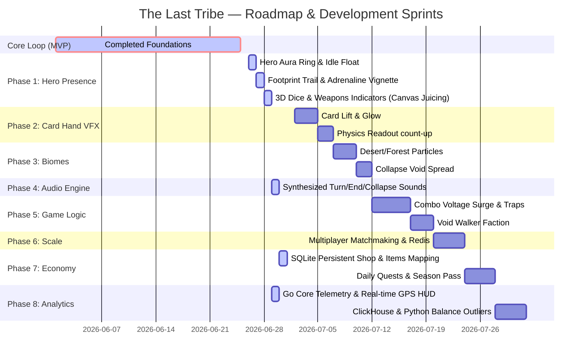

# 🗺️ New Integration Goals Roadmap
## The Last Tribe — Next-Gen Development Compass

> **Status snapshot:** MVP fully playable. Core loop: Ohm's Law physics, hex grid, 3 factions, turn FSM, SQLite persistence, lobby, matchmaking, adrenaline collapse, ambient VFX, spell trails, hero impact bursts — all live on localhost.



---

## ✅ Completed Foundations

| System | Module | Status |
|:---|:---|:---|
| Hex 3D grid (63 tiles, 9 metapositions) | `HexagonNode3D.jsx`, `HexMath3D.js` | ✅ Done |
| Ohm's Law card physics (V, R, I, P) | `PhysicsActionDataset.ts` | ✅ Done |
| Turn State Machine (5 phases) | `TurnStateMachine.ts` | ✅ Done |
| Algebraic Action Tensor | `AlgebraicActionTensor.ts` | ✅ Done |
| SQLite meta-progression | `DatabaseSyncManager.ts` | ✅ Done |
| Biome particles (snow, swamp vapor) | `HexagonNode3D.jsx` | ✅ Done |
| Adrenaline Collapse Director | `AdrenalineDirector.ts` | ✅ Done |
| Lobby + Socket.io matchmaking | `LobbyScreen.jsx`, `server.ts` | ✅ Done |
| Go Core microservice (port 8081) | `go-core/main.go` | ✅ Done |
| Web Audio API synthesizer | `ArenaAudio.js` | ✅ Done |
| Camera shake on impact | `CanvasRenderer3D.jsx` | ✅ Done |
| Hero impact VFX (burst + ring + orb) | `HeroImpactVFX.jsx` | ✅ Done |
| AAA spell projectile (comet + shards) | `SpellProjectile3D.jsx` | ✅ Done |
| Arena ambient particles (200 mana dust) | `ArenaAmbientParticles.jsx` | ✅ Done |
| Dynamic faction accent lighting | `CanvasRenderer3D.jsx` | ✅ Done |

---

## 🔵 Phase 1 — HERO AURA & BATTLEFIELD PRESENCE (✅ COMPLETED)
**Goal:** Every hero on the field radiates faction energy. The arena feels alive even between turns.

### 1.1 Hero Aura Ring (✅ Done)
- Continuous glowing torus around each hero, pulsing to the ambient audio LFO
- Crystal: cold blue `#00eeff` slow pulse | Toxic: acid green `#39ff14` fast shimmer | Druid: warm amber `#ffcc00` breath rhythm
- **File:** new `HeroAura.jsx`

### 1.2 Hero Idle Float Animation (✅ Done)
- Replace static billboard sprite with a gentle vertical sine-wave bob
- Low HP (≤ 5) → sprite flickers at 12Hz (alpha strobe)
- **File:** `ThreadMiniature.jsx`

### 1.3 Footprint Hex Glow Trail (✅ Done)
- Last 2–3 visited hexes leave a brief faction-colored residual emissive glow after movement
- **File:** `HexagonNode3D.jsx` + `App.jsx` (track last positions per thread)

### 1.4 Adrenaline Mode Vignette (✅ Done)
- When `AdrenalineDirector` activates: pulsing red/purple CSS vignette border around viewport
- Pulse rate increases as HP drops further
- **File:** new `AdrenalineVignette.jsx`

### 1.5 3D Dice & Equipped Weapon/Tool Floating Indicators (✅ Done)
- Above hero heads: floating wireframe D12 / D6 polyhedrons indicating active Aetheric Dice
- Floating next to pedestals: neon glowing 3D sabers and harvesting cogs representing shop equipment
- **File:** `ThreadMiniature.jsx`

---

## 🟠 Phase 2 — CARD PLAY ANIMATION & HAND VFX
**Goal:** Playing a card feels like casting a real spell. Every card interaction has visual weight.

### 2.1 Card Cast Lift Animation
- On play: card rises, scales up, then vanishes with a faction flash
- **File:** `ArenaUIOverlay.jsx` + `App.css`

### 2.2 Faction Glow on Card Hover
- Crystal: blue shimmer border | Toxic: green pulse | Druid: gold wave
- **File:** `ArenaUIOverlay.jsx`

### 2.3 Physics Readout Count-Up Animation
- Selected card + targeted hex → `V`, `R`, `I` numbers animate counting up
- `I ≥ 1.0` → green glow; `I < 1.0` → red flash
- **File:** `ArenaUIOverlay.jsx`

### 2.4 Ultimate Card Visual Distinction
- `isUltimate: true` cards get animated rainbow/gold border
- On play: fullscreen 0.15s white flash + ultimate orb profile
- **File:** `ArenaUIOverlay.jsx`, `SpellProjectile3D.jsx`

---

## 🟡 Phase 3 — BIOME BATTLEGROUND EXPANSION
**Goal:** Each of the 5 biomes has a unique visual fingerprint.

### 3.1 Desert Heat Shimmer
- `DESERT` tiles: rising heat haze particle points + Y-offset sine wave
- **File:** new `DesertHeatParticles.jsx`

### 3.2 Barrens Dust Devils
- `BARRENS` tiles: rotating mini whirlwind particle cluster
- **File:** new `BarrensDustDevil.jsx`

### 3.3 Lush Forest Fireflies
- `LUSH_FOREST` tiles at entropy > 0.5: 4–6 bobbing warm `#ffffaa` point lights
- **File:** new `ForestFireflies.jsx`

### 3.4 Biome Transition VFX
- Hero moves between biomes → brief splash VFX matching destination color
- **File:** `App.jsx` + new `BiomeTransitionVFX.jsx`

### 3.5 Arena Collapse Void Spread
- Collapsing hexes fade to black + ghostly purple void particles rise
- `HexagonNode3D` receives `isCollapsing` prop
- **File:** `HexagonNode3D.jsx`, `CanvasRenderer3D.jsx`, `App.jsx`

---

## 🟢 Phase 4 — AUDIO ENGINE EXPANSION (✅ COMPLETED)
**Goal:** Every meaningful game event has a synthesized audio signature.

### 4.1 Turn Start Chime (✅ Done)
- `playTurnStart(faction)` — Crystal: A4 | Toxic: D3
- **File:** `ArenaAudio.js`

### 4.2 Card Draw Sound (✅ Done)
- Dry cardboard-snap from noise burst oscillator
- **File:** `ArenaAudio.js`

### 4.3 Arena Collapse Warning Drone (✅ Done)
- Rising alarm drone loop starting at turn 8, intensifying each turn
- **File:** `ArenaAudio.js`

### 4.4 Victory / Defeat Fanfare (✅ Done)
- `playEndGame(winner)` — ascending chord on victory, minor fall on defeat
- **File:** `ArenaAudio.js`

### 4.5 Biome Ambient Crossfade (✅ Done)
- 2-second gain ramp between biome ambients (no hard cut)
- **File:** `ArenaAudio.js` → enhance `startAmbient()`

---

## 🔴 Phase 5 — GAME LOGIC EXPANSIONS
**Goal:** New mechanics that deepen strategy without breaking Ohm's Law rulebook.

### 5.1 Combo Chain System
- `V1 + V2 ≥ 8.0` → **Voltage Surge**: +2 bonus erosion + screen flash
- `R1 × R2 ≤ 1.0` → **Short Circuit**: opponent loses 1 card from hand
- **File:** `TurnStateMachine.ts`, `server.ts`

### 5.2 Terrain Trap Cards
- New card type: `TRAP` placed on a hex, triggers on enemy step
- Visual: pulsing skull icon floating above trapped tile
- **File:** `GameMap.ts`, `server.ts`, `HexagonNode3D.jsx`

### 5.3 Reactive Interrupt Window UI
- During `INTERRUPT_WINDOW`: countdown ring UI + `[REACT]` badge on eligible cards
- **File:** `ArenaUIOverlay.jsx`

### 5.4 Loot Chest Spawning
- 15% chance per turn-end: loot chest spawns on random empty tile
- Hero stepping on it: +1 material + XP
- **File:** `TurnStateMachine.ts`, `HexagonNode3D.jsx`

### 5.5 Fourth Faction — VOID WALKER
- Void Walker cards consume entropy instead of voltage
- At entropy > 0.7 → Void cards become free to cast
- Card palette: dark purple / silver
- **File:** new `voidBase.ts`, update `index.ts`, `PHYSICS_ACTION_DATASET`

---

## 🟣 Phase 6 — MULTIPLAYER & SPECTATOR SCALE
**Goal:** Support more than 2 players and add spectator mode.

### 6.1 2v2 Team Mode
- Two teams share a combined hand, alternate sub-turns
- Team voltage pooling: both players' `V` values sum
- **File:** `SovereignEngine.ts`, `server.ts`, `App.jsx`

### 6.2 Observer / Spectator Socket
- Third socket role: `spectator` — read-only `state_resolved` stream
- Read-only HUD with real-time physics readouts
- **File:** `server.ts`, new `SpectatorOverlay.jsx`

### 6.3 Tournament Bracket Engine
- 8-player bracket: 3 rounds → 1 champion
- FSM: `TOURNAMENT_PENDING` → `ROUND_1` → `ROUND_2` → `FINAL`
- **File:** new `TournamentEngine.ts`

### 6.4 Redis MMR Matchmaking Queue
- Replace in-memory `waitingPlayers[]` with Redis sorted set keyed by MMR
- Worker daemon: poll every 500ms, pair within ±100 MMR
- **File:** `server.ts` (ioredis), new `MatchmakingWorker.ts`

---

## ⚪ Phase 7 — META-PROGRESSION & ECONOMY (🔵 PERSISTENT SHOP INTEGRATED)
**Goal:** Players have reasons to return. Session-to-session growth loop.

### 7.1 Daily Quests System
- 3 rotating daily quests refreshed at UTC midnight
- Examples: "Win 2 as Crystal", "Deal 30 damage", "Move 10 tiles in one match"
- **File:** new `DailyQuestEngine.ts`, `DatabaseSyncManager.ts`

### 7.2 Card Rarity, Shard Crafting & Town Shop (✅ Persistent SQLite Shop & Inventory Mappings Done)
- 4 tiers: Common / Rare / Epic / Legendary — border glow: grey / blue / purple / gold
- Persistent Town Shop (`Chunk 0, Hex 0`) safe zone with hazard exclusion
- Persistent SQLite player item catalog transaction logs + player baseDamage modifier binding
- **File:** `DatabaseSyncManager.ts`, `itemsCatalog.ts`, `server.ts`, `ArenaUIOverlay.jsx`

### 7.3 Player Title System
- Earned titles in lobby and HUD: "Ohm's Apostle", "Void Weaver", "Arena Collapser"
- Stored as JSON array in `players.titles` column
- **File:** `DatabaseSyncManager.ts`, `LobbyScreen.jsx`

### 7.4 Season Pass Structure
- 30-tier seasonal XP-gated reward track: card backs, hero skins, avatar frames
- **File:** new `SeasonEngine.ts`, `DatabaseSyncManager.ts`

---

## ⚫ Phase 8 — BIG DATA ANALYTICS & AUTO-BALANCING (🔵 TELEMETRY PIPELINE LIVE)
**Goal:** Data drives game balance automatically.

### 8.1 Go Core Telemetry Stream & GPS Mapping (✅ Done)
- Go Core high-performance in-memory analytics store and coordinates to GPS conversion (Lat/Lng)
- Async combat logs posted from Node.js server to Go Core `/api/telemetry/combat`
- **File:** `go-core/main.go`, `server.ts`

### 8.2 Win-Rate & Play HUD Analytics (✅ Done)
- React client polling Go Core `/api/telemetry/analytics` every 3 seconds to fetch Big Data action distributions (Attack/Defense/Spell) and Voltage magnitude means
- **File:** `ArenaUIOverlay.jsx`

### 8.3 K-Means Auto-Balance Agent
- Clusters cards by `(avg_voltage, avg_resistance, win_rate)` → detects OP outliers → writes `rule_adjustments.json`
- **File:** `analytics/balance_analyzer.py`

### 8.4 Hot-Reload Rule Patches
- `server.ts` watches `rule_adjustments.json` via `fs.watch()` → reloads `PHYSICS_ACTION_DATASET` live
- **File:** `server.ts`, `PhysicsActionDataset.ts` (make dataset mutable)

### 8.5 Player Behavior Clustering
- Archetypes: Aggressor / Defender / Trickster / Chaos Agent
- Drives adaptive AI difficulty in `vs AI` mode via `NPCScriptDirector.ts`
- **File:** `analytics/player_clusters.py`, `NPCScriptDirector.ts`

---

## 📐 Architecture Dependency Map

```
Phase 1 (Hero Aura)         →  ThreadMiniature.jsx, App.jsx
Phase 2 (Card Animations)   →  ArenaUIOverlay.jsx, App.css
Phase 3 (Biome VFX)         →  HexagonNode3D.jsx + AdrenalineDirector
Phase 4 (Audio)             →  ArenaAudio.js + WebSocket events
Phase 5 (Game Logic)        →  TurnStateMachine.ts + server.ts
Phase 6 (Scale)             →  Phase 5 stable + Redis
Phase 7 (Economy)           →  Phase 6 stable + DatabaseSyncManager
Phase 8 (Analytics)         →  Phase 7 stable + ClickHouse + Python
```

---

## 📅 Suggested Sprint Order

| Sprint | Phase | Status | Effort | Impact |
|:---|:---|:---|:---|:---|
| Sprint 1 | Phase 1 — Hero Presence | ✅ Completed | ~1 day | 🔥 Immediate WOW |
| Sprint 2 | Phase 2 — Card Animations | 🔲 Planned | ~1 day | 🔥 Game feel leap |
| Sprint 3 | Phase 3 — Biome VFX | 🔲 Planned | ~2 days | 🎨 World depth |
| Sprint 4 | Phase 4 — Audio Expansion | ✅ Completed | ~1 day | 🎵 Immersion |
| Sprint 5 | Phase 5.1–5.3 — Logic | 🔲 Planned | ~3 days | ⚔️ Tactical depth |
| Sprint 6 | Phase 5.4–5.5 — Void faction | 🔲 Planned | ~2 days | 🃏 Content |
| Sprint 7 | Phase 6 — Multiplayer | 🔲 Planned | ~4 days | 🌐 Scope leap |
| Sprint 8 | Phase 7 — Economy (Shop / DB) | ✅ Completed | ~3 days | 🔁 Retention |
| Sprint 9 | Phase 8 — Analytics (Go / GPS) | ✅ Completed | ~4 days | 📊 AAA production |

---

> **Next Recommended Action:** Start **Sprint 2 — Card Animations**.
> Implement card cast lift effects (`ArenaUIOverlay.jsx`) and faction hovers to bring ultimate visual punch to card plays.

