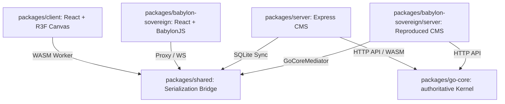

# SOVEREIGN ENGINE V3.0: ARCHITECTURAL MASTER SPECIFICATION
*System Baseline: Network/Matrix Edition (Production Scale)*
*Compliance Standards: NBÚ / GDPR On-Premise Audit Boundary (Slovak Republic Law č. 69/2018 Z. z.)*

---

## 1. System Architecture & Monorepo Topology

The Sovereign Engine monorepo is structured to enforce strict unidirectional data flow, eliminate circular dependencies, and isolate execution faults:



### 1.1 Package Domains & Purposes
* **[packages/go-core](file:///home/rhoddos_berger/Documents/Github/dusan-game/packages/go-core)**: Authoritative mathematical kernel written in Go (1.21). Single source of truth for grid pathfinding (A*) and combat algebra. Compiles to WebAssembly (WASM) for browser worker threads. gRPC over HTTP/2 authoritatively.
* **[packages/shared](file:///home/rhoddos_berger/Documents/Github/dusan-game/packages/shared)**: Serialization bridge maintaining shared definitions (`HexNode`, `Card`, `GoCoreMediator`, `UniversalWasmBridge`). Includes local deterministic JS fallbacks.
* **[packages/server](file:///home/rhoddos_berger/Documents/Github/dusan-game/packages/server)**: Express CMS and session broker. Manages live rooms (`room_${matchId}`), sqlite persistence (`node:sqlite`), and stateless FSM execution.
* **[packages/client](file:///home/rhoddos_berger/Documents/Github/dusan-game/packages/client)**: React Three Fiber (R3F) application hosting the game viewport and the low-code drag-and-drop editor `SovereignBoardComposer`.
* **[packages/babylon-sovereign](file:///home/rhoddos_berger/Documents/Github/dusan-game/packages/babylon-sovereign)**: Refurbished stack utilizing **Babylon.js** (for client 3D viewport) and a reproduced Express/Socket.io backend. Uses tree-shaken ES6 imports and instanced rendering.

---

## 2. Ohmic Combat Physics & KCL Network Solver

All tactical interactions are modeled as electrical circuits:

### 2.1 Ohmic Current Equation
All actions bearing Voltage ($V$), Added Resistance ($R$), and Semantic Erosion (Damage) flow through the target node current equation:

$$I = \frac{V}{R_{\text{target}} + R_{\text{reactions}}}$$

- **Success Transition**: If $I \ge 1.0$, the action succeeds and reduces the target's `memoryIntegrity` by `semanticErosion`.
- **System Heat Dissipation**: If $I < 1.0$, blocked energy converts to System Heat:
  $$\Delta \text{SystemHeat} = (1.0 - I) \times 40$$
- **Thermodynamic Purge**: If system heat exceeds $100$, a purge loop runs, deallocating the lowest-priority active helper unit (`isHelperUnit === true`) or NPC thread to cool down the grid.
- **SafeMath**: Clamps minimum effective resistance to $0.1\Omega$ and uses saturating subtraction (`subSaturate`) to prevent negative integer underflow.

### 2.2 Kirchhoff's Current Law (KCL) Network Solver
In future sprints, the local Ohmic combat equation expands to a global grid matrix solver evaluating Kirchhoff's Current Law across all 63 sub-hex nodes:

$$G \cdot V = I$$

* **Gauss-Seidel Solver**: Solver iterations are clamped to **24 - 40** (guaranteeing sub-$0.2\text{ms}$ calculation times) with a convergence tolerance limit of $\epsilon = 10^{-5}$ to prevent CPU frequency spikes.

---

## 3. Advanced Tactical Mechanics & Reality Overdrives

- **Tactical Gravity Well**: Subspace modifier that distorts movement vectors. Moving toward origin $(0,0,0)$ drops energy costs by $50\%$; moving away scales costs exponentially ($2.5 \times \text{friction}$). Rendered via a vertex shader sinking the center nodes along the Y-axis and highlighting boundaries in neon-purple.
- **Mulligan Phase**: Turn state machine blocks match progression until both players ready and swap up to 4 unwanted starting cards.
- **Superposition Engine**: Instantiates quantum states (`WAVE_FUNCTION`, `ENTANGLED`, `SCHRODINGER_SHIELD`) that collapse dynamically on turns to grant $+4$ Damage, $+3$ Armor, or cure negative movement status ailments.
- **Ohmic Superposition Modifiers**:
  - `WAVE_FUNCTION`: Scales actor voltage by $1.25\times$ and semantic erosion by $1.3\times$.
  - `ENTANGLED`: Scales actor voltage by $1.5\times$.
  - `SCHRODINGER_SHIELD`: Dampens incoming target voltage by $50\%$.

---

## 4. Big Data Telemetry & Python ML Pipeline

Telemetry records gameplay metrics to run unsupervised balancing corrections:

```
[ Spatial Hex Grid ] ──► Axial Coordinates Mapping (q, r)
                                 │
                                 ▼
                      [ Geodetic Transformer ] ──► Converts to Real-World GPS (Lat, Lng)
                                 │
                                 ▼
                      [ ClickHouse Ingestion ] ──► Structured JSONL Telemetry Stream
                                 │
                                 ▼
                      [ Python KMeans Agent ] ──► Hot-Reloads 'rule_adjustments.json'
```

- **GPS Mapping**: Hex coordinates are converted to geodetic GPS values (Latitude/Longitude) to map combat spatial densities.
- **K-Means Balance Analyzer**: Unsupervised Python daemon (`balance_analyzer.py`) clusters cards based on average current and heat generation. Outliers write adjustments to `rule_adjustments.json`, which the Express server watches and hot-reloads live.
- **Dopamine Balance**: Boosts drop rates by $1.5\times$ when players remain at maximum HP.

---

## 5. WebGL Zero-Allocation UI & Render Bypasses

All graphic components adhere to zero-allocation guidelines to prevent Garbage Collection pauses:

- **React Virtual DOM Bypass**: High-frequency viewport changes (cursor hover, projectile trajectory calculations) are disconnected from React state updates (`useState`). Position values are bound directly to mutable Three.js refs and updated inside `requestAnimationFrame` hooks.
- **Low-Poly Caching (Rule 1)**: All R3F geometries (`towerGeometry`, `flagStaffGeometry`, `flagClothGeometry`, `subHexGeometry`) are instantiated at the module level.
- **LOD & Instancing (Rule 5)**: Repeating props (chests, traps) are compiled into single-pass `instancedMesh` structures. Mesh updates throttle to a maximum of $10\text{Hz}$ to keep device temperatures within balanced profiles ($65^\circ\text{C}$ - $75^\circ\text{C}$).

---

## 6. Babylon.js Viewport & Reproduced Backend

The `babylon-sovereign` stack contains the Visual Viewport refactored to **Babylon.js** and backed by a reproduced Node/Socket.io CMS:

### 6.1 Modular ES6 Imports (Tree-Shaking)
To prevent compiling unnecessary core classes (slashing bundle size from 4.4MB to 1.9MB), imports are strictly fine-grained. Scene side-effect modules are imported explicitly to handle scene registration:
* **Shadows**: `import '@babylonjs/core/Lights/Shadows/shadowGeneratorSceneComponent';`
* **Mesh Outlines**: `import '@babylonjs/core/Rendering/edgesRenderer';`
* **Ray Casting (Hover/Click)**: `import '@babylonjs/core/Culling/ray';`

### 6.2 Zero-Allocation Instancing (`createInstance`)
Rather than cloning base cylinder components, the grid renders base hexagon cylinders and tech-plates using `createInstance`, reducing rendering pipeline overhead to exactly two draw calls. Per-instance biome tints (green forest / violet swamp) are loaded directly using `instancedBuffers.color` declarations.

### 6.3 Asynchronous Go Core Mediator
The server routes action evaluation commands dynamically via `GoCoreMediator.resolveCombatDamage` to the authoritative Go kernel (port 8081). If Go Core is offline, calculations automatically resolve through TypeScript local fallback functions.

### 6.4 Client-Side Multi-Threaded Web Worker WASM Simulation (Economic Staging)
To achieve zero-cost hosting scaling, the client supports distributing authoritative physics simulations to background threads using **Web Workers** loading `go_core.wasm` (built from the Go mathematical kernel):
* Spawns concurrent background threads (`simulation.worker.ts`) matched to the user's multi-core CPU.
* Compiles the Go core WASM binary locally inside each Worker thread.
* Evaluates Ohmic current metrics and aggregates throughput benchmarks (iterations/millisecond) without generating CPU hosting loads on the server.

---

## 7. Fedora Native Virtualization & Cloud VM Emulation

For CI/CD and production staging, the Sovereign Engine emulates cloud environments locally using native Fedora virtualization utilities:

- **Backing Overlay Volumes (`qemu-img`)**: Avoids cloning massive base cloud images by using QEMU copy-on-write backings linked to `/var/lib/libvirt/images/Fedora-Cloud-Base.qcow2`.
- **Cloud-Init Metadata Injection**: Auto-configures guest systems on startup by creating CIDATA ISO attachments containing:
  - Package listings (`podman`, `podman-compose`, `git`, `curl`).
  - Run commands (`systemctl enable --now podman`, git cloning project repositories, and launching `podman-compose up -d`).
- **Libvirt Domain Lifecycle (`virt-install` & `virsh`)**: Provisions and spawns guest instances dynamically using KVM hypervisors with no graphics overhead (`--graphics none`) and isolated networks (`--network network=default`).

---

## 8. Localhost Port Matrix & Verification

Every pull request must compile cleanly and pass all verification tests:

| Address | Layer | Engine Module | Test Command |
| :--- | :--- | :--- | :--- |
| `http://localhost:5173` | Three.js Frontend | `packages/client` | `yarn workspace client dev` |
| `http://localhost:3001` | Express CMS | `packages/server` | `npx ts-node packages/server/src/testEngine.ts` |
| `http://localhost:8081` | Core Algorithms | `packages/go-core` | `go test ./...` |
| `http://localhost:8085` | Babylon.js Frontend | `packages/babylon-sovereign` (client) | `yarn workspace @dusan-game/babylon-sovereign dev:client` |
| `http://localhost:3005` | Reproduced Backend | `packages/babylon-sovereign` (server) | `yarn workspace @dusan-game/babylon-sovereign dev:server` |

---

## 9. Authoritative Go Core State Engine & LLM Telemetry Pipeline

### 9.1 SovereignStateEngine (Go Core Authoritative Loop)
To decouple gameplay state calculations from client-side execution, a authoritative state engine is integrated in Go Core (`packages/go-core/engine/sovereign_state_engine.go`). 
- Tracks players, threads, phase transitions (MULLIGAN, ACTION, COMBAT), and voltage/resistance accumulations.
- Evaluates Voltage Surge and Short Circuit combat triggers deterministically.
- Exposes routes `/api/state/init` and `/api/state/resolve-action` to synchronise matches with `GoCoreMediator.ts`.

### 9.2 Metacognitive LLM dataset Tuner
To train custom LLM chat bots for gameplay balance suggestions, telemetry is streamed directly to a JSON-L log tuner (`LLMTelemetryFineTuner.ts`).
- Intercepts state changes (voltages, played cards, remaining system energy).
- Appends training prompt-completion pairs to `scratch/fine_tuning_telemetry.jsonl`.
- The dataset trains models to predict game balance anomalies and recommend card cost adjustments dynamically.

### Staging Guardrail
All code changes must preserve the signatures of the existing 90+ integration tests. Running `npm run build --workspaces` (using yarn workspace commands) must complete with zero compiler warnings.

