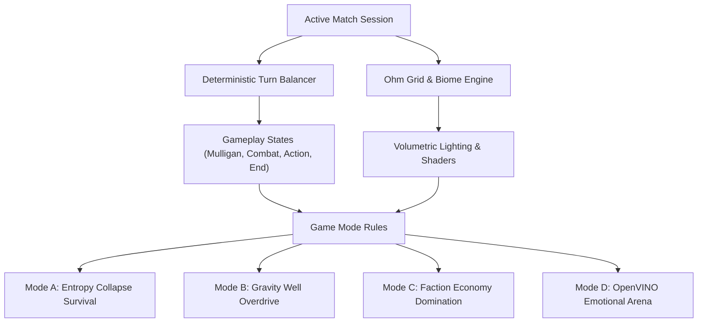

# Creative Game Modes & Prompt Syntactic Manual

This design manual details the creative game modes, prompt architectures, and syntactic parsing engines used to regulate and distribute content across the Sovereign game engine.

---

## 1. Architectural Blueprint: Game Modes Integration

The Sovereign engine leverages decoupled microservices (Go Core pathfinders and the TypeScript fallback) to drive procedurally changing game environments. The game modes described below are layered dynamically on top of the active hexagonal grid and turn balancer.



---

## 2. Creative Game Mode Playbook

### Mode A: Entropy Collapse Survival
*   **Overview**: An intense PvE/PvP mode where the outer hex rings collapse and sink below the fog line as global entropy stochastically escalates.
*   **Mechanics**:
    *   Every 3 turns, tiles with high hazard indexes (`hazardIndex > 0.7`) deform and sink (`position.z` lowers to `-5.0`).
    *   Players must navigate towards dynamic escape paths spawned by the retention motivation sub-system.
*   **VFX**: Glow outlines shift from cyan to flashing red, cosmetic portal speeds double.

### Mode B: Tactical Gravity Well Overdrive
*   **Overview**: High-intensity arena combat focused on kinetic displacements and gravity pulls.
*   **Mechanics**:
    *   Activating a card with `voltage > 60V` establishes a gravity well at the target hex.
    *   At the end of each turn segment, adjacent units are pulled 1 hex closer to the center.
*   **VFX**: Radial ripple waves deform the elevation map, volumetric God Rays focus on the gravity epicenter.

### Mode C: Faction Economy Domination
*   **Overview**: A slow-paced strategic mode emphasizing card fusions, trades, and quest completions.
*   **Mechanics**:
    *   Winning requires players to complete trade-quest contracts generated by the database engine.
    *   Prisma interactive transactions ensure atomic card transfers between players.
*   **VFX**: Clean, matte tech-plate plates with low-poly flags mapping active ownership.

### Mode D: OpenVINO Emotional Arena
*   **Overview**: A highly adaptive gameplay experience where the environment responds directly to the player's physical and emotional states.
*   **Mechanics**:
    *   High stress or fatigue (blink spikes or facial tension) triggers spawning of helper kits.
    *   Difficulty scaling drops resistance costs when players are fatigued.
*   **VFX**: Dynamic neon edge colors pulse in sync with the player's tracked gaze parameters.

---

## 3. The Prompt Queue & Syntactic Parser

To ensure prompt generation remains syntactically consistent, we parse prompt instructions into four core syntactic components:

$$\text{Prompt} = \langle \text{Action Verb} \rangle + \langle \text{Target System} \rangle + \langle \text{Semantic Parameters} \rangle + \langle \text{Fallback Logic} \rangle$$

### Syntactic Parsing Table

| Prompt ID | Action Verb | Target System | Semantic Parameters | Fallback Logic |
| :--- | :--- | :--- | :--- | :--- |
| **PR-001** | `Compile` | WASM Go Core | `packages/go-core/wasm/main.go` -> `go_core.wasm` | Fallback to TS Biome/ML helper |
| **PR-002** | `Log` | ClickHouse Telemetry | Port `8123`, combat & terrain events | Route to SQLite WAL registers |
| **PR-003** | `Deform` | HexagonNode3D | Lerp opacity to `0.82`, metallic reflection | Render matte outer base block |
| **PR-004** | `Track` | OpenVINO Analytics | `/api/telemetry/vision`, blink count, emotion | Use default steady fatigue values |

---

## 4. Generative Prompt Combinations (New Goals)

By combining components from the parsed queue in a similar tone, developers can spawn prompts for upcoming features:

### Combined Prompt 1: Adaptive Gravity Collapse Mode
```markdown
# Role & Task
Implement the Adaptive Gravity Collapse Mode integration:
1. Listen to /api/telemetry/vision; if player emotion is classified as STRESSED, activate Mode B (Gravity Well Overdrive).
2. Trigger radial ripple wave deformation deforming adjacent hexes' Z coordinates from 0.0 to -3.0.
3. Fallback to default linear dash formulas if Go Core WASM mediator is offline.
```

### Combined Prompt 2: Volumetric Telemetry Tracker
```markdown
# Role & Task
Implement the Volumetric Telemetry Tracker integration:
1. Query active player sessions from /api/backoffice/sessions.
2. If socket latency exceeds 150ms, throttle uniform updates from database polling to 5Hz.
3. Fallback to rendering low-poly placeholder billboards for props if GPU limits are breached.
```

---

## 5. Extended Feature Proposals & Core Mechanics

The core game modes are designed to be extensible. Below are proposed features that synthesize mechanics from multiple modes:

### Feature A: Dynamic Terrain Resonator (Extension of Mode A & B)
*   **Overview**: An active combat hazard where high-voltage moves cause local seismic shockwaves that weaken and eventually collapse tiles.
*   **Mechanics**:
    *   Combat actions with `voltage > 75V` trigger a local height vibration loop on adjacent tiles.
    *   Affected tiles suffer a temporary reduction in walkability, and if they are already damaged (`hazardIndex > 0.6`), they crack and collapse into the void after 2 turns.
*   **VFX**: Fast-jittering tile elevations and volumetric amber light shafts emitting from fractured cracks.

### Feature B: Automated Trade Broker (Extension of Mode C)
*   **Overview**: Dynamic AI-driven resource pricing based on the current composition of the player's hand and card fusions.
*   **Mechanics**:
    *   The database engine monitors card compile times and faction distribution.
    *   If crystal cards are abundant on the grid, the buy-value of toxic cards rises by 35% to promote strategic trading.
*   **VFX**: A floating holographic price chart above the Central Town Building.

### Feature C: Cognitive Companion Drone (Extension of Mode D)
*   **Overview**: An in-game helper entity that hovers around the hexagonal grid and moves toward the player's active focus area.
*   **Mechanics**:
    *   OpenVINO gaze tracking maps the player's coordinate focus to the grid.
    *   The companion drone moves to the focused hex and deploys a tactical energy barrier if the player's fatigue index exceeds `0.7`.
*   **VFX**: Hovering drone mesh with glowing neon trails matching the active faction theme.

---

## 6. Prompt Queue Extensions & Combined Prompts

To construct these extended features, we expand the Prompt Queue with additional syntactic tokens:

### Extended Syntactic Parsing Table

| Prompt ID | Action Verb | Target System | Semantic Parameters | Fallback Logic |
| :--- | :--- | :--- | :--- | :--- |
| **PR-005** | `Vibrate` | TerrainResonator | Range 2 hexes, high-frequency Z jitter | Apply static height offset -1.0 |
| **PR-006** | `Fluctuate` | TradeBroker | Abundance factor > 1.5, +35% shard cost | Use fixed catalog market rates |
| **PR-007** | `Hover` | CompanionDrone | OpenVINO gaze mapping, fatigue barrier | Standby at current hero coordinate |

### Combined Prompt 3: Cognitive Companion Shielding
```markdown
# Role & Task
Implement the Cognitive Companion Shielding integration:
1. Map player gaze from /api/telemetry/vision to locate the active focused hex node.
2. If fatigue index exceeds 0.7, trigger PR-007 (Hover) to move the companion drone to the coordinate.
3. Deploy a tactical barrier modifying walkability on the target tile; fallback to standby at hero coordinate if vision client is offline.
```

