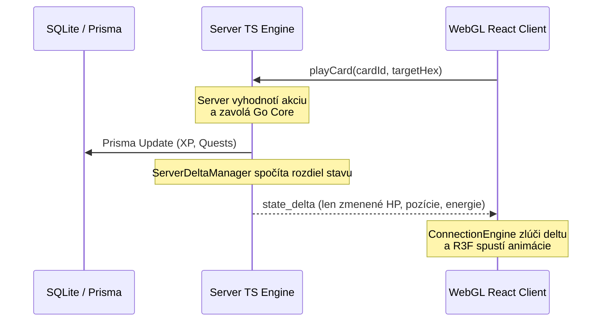

# Databázové Objekty a Priradenie k Štruktúram Kódu

Tento dokument slúži ako kompletný dizajn manuál a technický prehľad mapovania medzi perzistentnou vrstvou (databáza SQLite cez Prisma ORM) a pamäťovými/sieťovými hernými štruktúrami (TypeScript / React Three Fiber).

---

## 1. Prehľadová Tabuľka: Databáza vs. Runtime Objekty

Táto tabuľka zobrazuje, ako sú jednotlivé modely zadefinované v databázovom schéme (`schema.prisma`) mapované na konkrétne TypeScript rozhrania a triedy v hre.

| Prisma Model | Zodpovedajúci TS Kód / Interface | Umiestnenie v Kóde | Tok Synchronizácie (Sync Flow) |
| :--- | :--- | :--- | :--- |
| `Player` | `NetworkThreadState` / `Thread` | `packages/shared/src/core/types.ts`<br>`packages/server/src/models/Thread.ts` | Načítaný pri štarte zápasu z DB; zmeny stavu (HP, XP) sa zapisujú na konci zápasu. |
| `Inventory` | `materials` (Record) | `packages/shared/src/core/types.ts` | Materiály získané z truhlíc (`LootChest3D`) sa ukladajú do DB cez Prisma transakcie. |
| `PlayerCard` | `deck` / `currentBuffer` (`Instruction`) | `packages/shared/src/core/types.ts`<br>`packages/server/src/models/Instruction.ts` | Definuje modifikované karty (V, R). Pri zahraní prechádza do `discardPile`. |
| `PlayerQuest` | `PlayerQuest` / `Quest` | `packages/shared/src/core/types.ts`<br>`packages/shared/src/core/QuestTriggerManager.ts` | Spravované cez `ServerQuestIntegration`. Ukladá progress, status a XP odmeny. |
| `PlayerItem` | `PlayerItem` / `ITEMS_CATALOG` | `packages/shared/src/core/types.ts`<br>`packages/shared/src/data/itemsCatalog.ts` | Položky nakúpené v obchode (`Town Shop`), ktoré ovplyvňujú životnosť a poškodenie. |
| `PlayerArtifact` | `PlayerArtifact` / Štatistické Bonusy | `packages/shared/src/core/types.ts` | Unikátne predmety triedy hrdinu (napr. `spellReachBonus`, `damageBonus`). |
| `CardTrade` | `CardTrade` / Obchodné Transakcie | `packages/shared/src/core/types.ts` | Evidencia otvorených ponukových a dokončených swap transakcií medzi hráčmi. |

---

## 2. Detailné Databázové Polia a Dátové Typy

### A. Model `Player` (Účet Hráča & Jadro Štatistík)
Predstavuje perzistentný profil hráča mimo zápasu a slúži ako základ pre MMR a úroveň.

| Názov Stĺpca | Typ v Prisma | Typ v TS | Predvolená hodnota | Význam a Využitie v Kóde |
| :--- | :--- | :--- | :--- | :--- |
| `id` | `String` | `string` | `uuid()` | Unikátny identifikátor hráča slúžiaci ako primárny kľúč. |
| `username` | `String` | `string` | - | Prihlasovacie meno. |
| `email` | `String` | `string` | - | E-mail pre registráciu. |
| `passwordHash` | `String` | `string` | - | Šifrované heslo. |
| `level` | `Int` | `number` | `1` | Aktuálna RPG úroveň hráča. |
| `xp` | `Int` | `number` | `0` | Získané skúsenosti, navyšované cez dokončené Questy. |
| `mmr` | `Int` | `number` | `1000` | Matchmaking Rating slúžiaci pre vyvažovanie súperov v lobby. |

### B. Model `Inventory` (Materiálové Suroviny)
Ukladá materiály vyťažené počas zápasov, ktoré slúžia na fúziu a crafting kariet.

| Názov Stĺpca | Typ v Prisma | Typ v TS | Predvolená hodnota | Význam a Využitie v Kóde |
| :--- | :--- | :--- | :--- | :--- |
| `id` | `String` | `string` | `uuid()` | Unikátny identifikátor záznamu. |
| `playerId` | `String` | `string` | - | Cudzí kľúč odkazujúci na `Player.id`. |
| `materialKey` | `String` | `string` | - | Kľúč suroviny (`CrystalShard`, `ToxicSpore`, `Essence`). |
| `amount` | `Int` | `number` | `0` | Množstvo suroviny vlastnené hráčom. |

### C. Model `PlayerCard` (Odomknuté & Upravené Karty)
Zodpovedá balíčku kariet, ktoré môže hráč použiť v zápase. Obsahuje možnosť uloženia vlastných hodnôt fyzikálnych veličín (V, R).

| Názov Stĺpca | Typ v Prisma | Typ v TS | Predvolená hodnota | Význam a Využitie v Kóde |
| :--- | :--- | :--- | :--- | :--- |
| `id` | `String` | `string` | `uuid()` | Unikátny ID konkrétnej karty hráča. |
| `playerId` | `String` | `string` | - | Vlastník karty (`Player.id`). |
| `cardDefinitionId`| `String` | `string` | - | Referenčný ID kľúč základnej karty (napr. `crystal_laser_burst`). |
| `customVoltage` | `Float?` | `number \| null` | `null` | Upravené napätie karty prostrednívom craftingu. |
| `customResistance`| `Float?` | `number \| null` | `null` | Upravený elektrický odpor karty po craftingu. |
| `isShiny` | `Boolean` | `boolean` | `false` | Kozmetický príznak prémiovej vizuálnej emisie karty. |

### D. Model `PlayerQuest` (Denné Výzvy)
Sleduje priebeh plnenia úloh, ktoré hráč počas zápasov realizuje.

| Názov Stĺpca | Typ v Prisma | Typ v TS | Predvolená hodnota | Význam a Využitie v Kóde |
| :--- | :--- | :--- | :--- | :--- |
| `id` | `String` | `string` | `uuid()` | ID priebehu úlohy. |
| `playerId` | `String` | `string` | - | ID priradeného hráča. |
| `questKey` | `String` | `string` | - | Typ úlohy (napr. `WIN_MATCH_CRYSTAL`, `COLLECT_CHESTS`). |
| `progress` | `Int` | `number` | `0` | Aktuálny priebeh plnenia (napr. počet vyhraných kôl). |
| `targetValue` | `Int` | `number` | - | Cieľová hodnota pre úspešné dokončenie úlohy. |
| `completed` | `Boolean` | `boolean` | `false` | Príznak dokončenia úlohy. |
| `xpReward` | `Int` | `number` | - | Odmena v XP po odovzdaní úlohy. |

---

## 3. Štruktúry Kódu v Pamäti (In-Memory Gameplay Štruktúry)

V momente, keď sa spustí aktívny zápas, databázové informácie sa zoserializujú do dynamického stavu hry (`NetworkEngineState`), ktorý je periodicky prenášaný cez WebSocket na klienta.

### A. Typy Hracích Entít v Pamäti (`Thread`)
Každá entita na hracej ploche dedí z objektu `Thread` (v klientskom rozhraní reprezentovaná ako `NetworkThreadState`):

```typescript
export interface NetworkThreadState {
    id: string;                      // Unikátny identifikátor entity (hráč / pomocník)
    name: string;                    // Zobrazované meno
    type: 'PLAYER' | 'NPC' | 'HELPER'; // Charakteristika typu entity
    ownerId?: string | null;         // Vlastník (pri pomocníkoch typu veža / past)
    health: number;                  // Aktuálne HP
    maxHealth: number;               // Maximálne HP
    armor: number;                   // Redukcia poškodenia
    attackReach: number;             // Dosah útokov (červené karty)
    spellReach: number;              // Dosah kúzlenia (modré karty)
    movementBase: number;            // Počet políčok pohybu za tah
    isSlowed: boolean;               // Negatívny stav: Spomalenie
    isRooted: boolean;               // Negatívny stav: Zakorenenie
    isSilenced: boolean;             // Negatívny stav: Umlčanie
    isDisarmed: boolean;             // Negatívny stav: Odzbrojenie
    position: { 
      meta: number | null;           // Metapozícia (sektor) na gridu
      hex: number | null;            // Lokálny index hexagonu
    };
    currentBuffer: any[];            // Karty aktuálne držané v ruke
    discardPile: any[];              // Odhadzovací balíček
    deck: any[];                     // Dobírací balíček v zápase
}
```

### B. Typy Pomocníkov (Units / Helpers)
Na základe poľa `unitType` v `Card` rozhraní rozlišujeme nasledovné in-memory entity:

1. **Past (`trap`)**:
   - **DB Dáta:** Kľúč karty zahraný ako `HELPER` so špecifickým umiestnením.
   - **Využitie v kóde:** Zapisuje sa do `NetworkBlockState.hasTrap = 'ROOT_TRAP' | 'EMP_MINE' | 'STATIC_CHARGE_TRAP'`.
   - **Aktivácia:** Vyhodnocovaná v `engine.triggerTrapCheck()`. Spúšťa sa automaticky, ak nepriateľský Hrdina opustí daný hex.
2. **Bomba (`bomb`)**:
   - **DB Dáta / Kód:** Podobné ako past, no s okamžitou explóziou pri vstupe nepriateľa na políčko s bombou.
3. **Veža (`tower`)**:
   - **Kód:** Vstupuje na bojisko ako samostatný `Thread` s typom `HELPER`.
   - **Mechanika:** Vstupuje vyčerpaná (vodorovne otočená, `active = false`). Pripraví sa (svisle) na začiatku ťahu vlastníka.
4. **Strážca (`watcher`)**:
   - **Kód:** Trvalý pomocník na ploche. Má vlastné HP body a útočí v každom kole, kým nie je zničený.

---

## 4. Mapovanie 3D Renderovaných Objektov (Render Engine)

R3F Render Engine konzumuje stav gridu (`NetworkBlockState`) a dynamicky na jeho základe inštanciuje alebo upravuje 3D modely a shader parametre.

| Interaktívny Prvok na Hexagonu | Zodpovedajúci Property v `NetworkBlockState` | 3D Renderovaný Komponent v Kliente | Použitý Shader & Efekty |
| :--- | :--- | :--- | :--- |
| **Truhlica s pokladom** | `hasChest === true` | `<LootChest3D>` | PBR zrkadlové odrazy, emisia pri otvorení. Animuje sa otvorenie veka pri zmene ťahu. |
| **Past na zemi** | `hasTrap !== null` | `<Trap3D>` | Animácia otvárania čeľustí pasti na základe parametra `turnsElapsed`. |
| **Centrálne mesto** | `isTown === true` | `<TownBuilding3D>` | Procedurálny stredový hrad s rotujúcou bránou. |
| **Opravná sada** | `hasOpportunity === 'REPAIR_KIT'` | `<RepairKit3D>` | Rotujúca 3D kapsula s vysúvacími krytmi pri zmene ťahu. |
| **Zosilňovač (Surge Node)** | `hasOpportunity === 'SURGE_NODE'` | `<SurgeNode3D>` | Emisný torus simulujúci nahromadenú energiu. |
| **Void Rift (Trhlina)** | `hasOpportunity === 'VOID_RIFT'` | `<VoidRift3D>` | Časticový čierny vír s horizontálnou deformáciou Z osi hexu. |
| **Frakčná Vlajka** | `hasOpportunity === 'FLAG_COLLECT'` | `<FactionFlag3D>` | Vlajúca 3D zástava vo farbe klanu. |

---

## 5. Serializácia a Prenos Stavov (Delta-Compression)

Pre minimalizáciu prenosu dát po sieti WebSocket neprenáša celý stav zápasu, ale len zmeny v atribútoch:



Dáta prenášané v `state_delta` obsahujú iba zmenené vetvy (napr. `{ threads: [{ id: "player_1", health: 12 }] }`), čo šetrí šírku pásma a urýchľuje odozvu UI.
