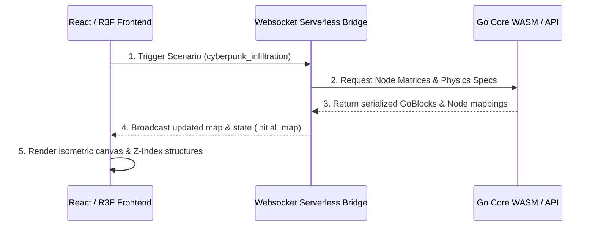

# Genetic vs. Generic Algorithms & Cross-Technology Integration Map

This playbook evaluates the application of **Genetic/Evolutionary** versus **Generic/Procedural** algorithms within the Sovereign Engine v2.0, detailing how calculations resolve in Go Core and synchronize with the React/TypeScript canvas.

---

## 1. Algorithm Paradigm Comparison

| Attribute | Genetic / Evolutionary Algorithms | Generic / Procedural Algorithms |
| :--- | :--- | :--- |
| **Methodology** | Mutation, crossover, and fitness evaluations over generations. | Rule-based, deterministic formulas and fractal subdivisions. |
| **Best Suited For** | Optimal NPC strategy balancing, high-fidelity spawner distributions, and card synergy evaluations. | Pathfinding (A*), physics energy costs (Ohm's Law), and baseline terrain structures. |
| **Visual representation** | Generates organic, complex distributions that mimic natural behavior (e.g. foliage groupings). | Produces uniform, geometric hex configurations, structured lanes, and Z-Index grid layers. |
| **CPU Cost** | High: Staged over multiple frames or deferred to background web workers. | Low: Solved instantly within a single frame calculation. |

---

## 2. Go Core & TypeScript Cross-Layer Mapping

To maintain high performance and low-latency rendering, the engine segments operations between the Go binary and the TypeScript runtime.



### Valid Cross-Technology Combinations:
1.  **Grid Calculations (Go Core)**:
    *   *Inputs*: Coordinates `[chunkId, blockId]`, hazard values, friction values.
    *   *Computation*: Go Core calculates pathfinding costs using deterministic A*.
    *   *Output*: An array of paths sent via HTTP/REST or WebSockets.
2.  **Visual Render (TypeScript / R3F)**:
    *   *Consumption*: Deserializes the Go output array into Cartesian coordinates.
    *   *Rendering*: Emits glowing blue vector arrows or moves 3D low-poly miniature meshes along the calculated vectors.
3.  **Aesthetics and CSS Overrides (Backoffice)**:
    *   *Backoffice Controls*: Adjusts parameters in the JSON scenario templates.
    *   *CSS Snippet Injection*: Inserts custom CSS styling tags to instantly refresh the glassmorphism UI overlays and glowing borders of the canvas.

---

## 3. Backoffice-to-Frontend Data Structure

Scenario templates are structured in JSON database configurations to enable quick loading and websocket synchronization:

```json
{
  "scenario": {
    "id": "cyberpunk_infiltration",
    "difficulty": 2,
    "nodeMappings": [
      {
        "nodeId": "thread_king_ai",
        "coordinates": [0, 0],
        "stats": {
          "memoryIntegrity": 20,
          "semanticErosion": 0
        }
      }
    ]
  }
}
```
*   **Backoffice Representation**: Progress bars monitor parameters like *Entropy Factors* and *Friction Multipliers*.
*   **Canvas Representation**: Extrudes tiles to their corresponding Z-Index levels (`A_BASE`, `A_CENTER`, `A_OVERHEAD`) and spawns low-poly miniatures on walkable blocks.
