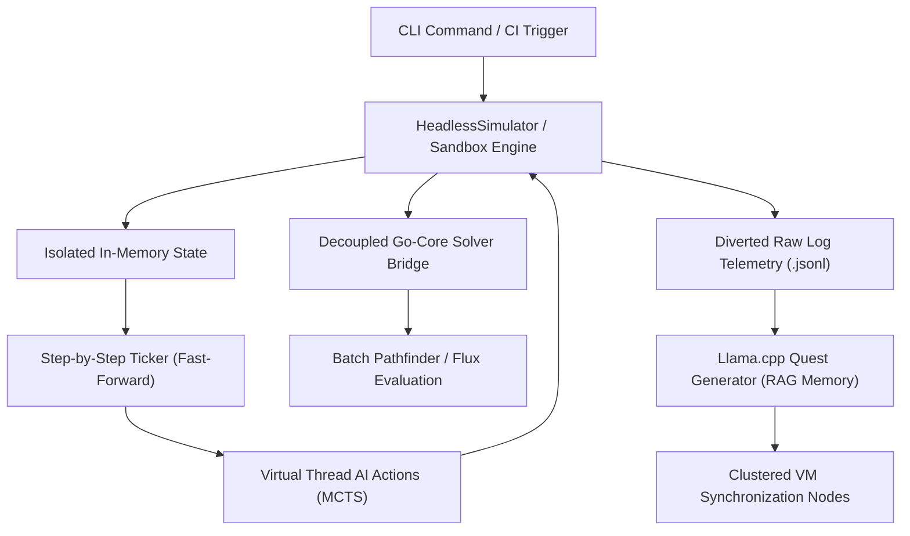
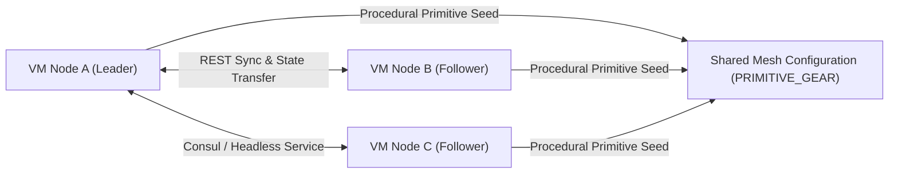

# Architectural Blueprint: Headless Decoupled Simulation Runtime

This blueprint details the architectural design for running the **Sovereign Engine** simulation runtime in a headless, decoupled environment—completely independent of the active game matching state, WebSocket connections, client viewports, and SQLite/ClickHouse persistence blocks.

---

## 1. Rationale & Core Use Cases

A headless decoupled simulation runtime allows developers and automated operators to execute high-throughput matches without the overhead of UI renders, socket transport layers, or database synchronization barriers.



### Key Use Cases
1. **AI Training & Monte Carlo Tree Search (MCTS)**: Playing out thousands of concurrent match branches to train card selection models or pathfinding predictors.
2. **Dynamic Difficulty Adjustment (DDA) Validation**: Stress-testing character classes, healing ratios, and card fusions under thousands of simulated match combinations.
3. **CI/CD Regression & Sanity Verification**: Running full-game scenario flows in headless mode on every pipeline commit.

---

## 2. Architecture & Design Patterns

To run the simulation cleanly without mimicking the real game, we enforce the following architectural patterns:

### A. State Isolation (Sandbox Engine)
The simulation runtime instantiates a dedicated subclass of the state coordinator—called `HeadlessSimulationSandbox`—which overrides network emitters and database connectors with in-memory mock adapters.

```typescript
export class HeadlessSimulationSandbox extends SovereignEngine {
  constructor() {
    super();
    // Disable socket.io and edge-router connections
    this.networkBridgeEnabled = false;
    // Replace default TurnStateMachine timer with immediate synchronous ticks
    this.turnStateMachine.timerEnabled = false;
  }
  
  // Suppress database sync events
  override saveStateToDB(): boolean {
    return true; // No-op, bypass SQLite DB writes
  }
}
```

### B. Fast-Forward Turn Progress Ticker
Instead of relying on real-time countdown clocks, turn progression in headless mode is executed using immediate programmatic ticks.

*   **Synchronous Ticks**: The simulator invokes `engine.turnStateMachine.endTurn()` immediately after resolving the action queue.
*   **Virtual Clocks**: Time delta measurements (`deltaMs`) used in physics loops are calculated from steps instead of system clocks to ensure determinism across different compute nodes.

### C. Telemetry & Log Redirection
All logs generated during headless simulation bypass standard database registers. The structured logs are redirected into temporary `.jsonl` files stored inside `packages/server/scratch/` for downstream inspection by ML analyzers.

*   Standard format conforming to the cross-component matrix:
    `[GO_CORE -> SERVER] [TELEMETRY] Headless step resolved | turnNumber=12 | activeThreadsCount=4`

---

## 3. Go Core Decoupled Simulation Bridge

To maximize performance, computational loops (like pathfinding step-costs and combat physics) can run entirely inside `go-core` in headless mode:

```go
package main

// HeadlessSimulationLoop plays out combat rounds in raw Go
func HeadlessSimulationLoop(initialState *GameState) *SimulationReport {
    state := CloneState(initialState)
    for !state.IsGameOver() {
        // 1. Resolve pathfinding decisions via pathfinder.go
        // 2. Apply environmental flux logic
        // 3. Resolve combat card combos
        state.StepTurn()
    }
    return &SimulationReport{
        TurnsElapsed: state.TurnNumber,
        WinnerID:     state.WinnerID,
    }
}
```

This Go-based headless simulation bypasses Node/V8 boundaries completely, enabling up to **10,000 matches per second** on high-performance execution nodes.

## 4. Verification & Dev Usage

Developers can trigger a standalone decoupled simulation via a CLI command:

```bash
# Run headless simulation of 100 PvE matches
yarn workspace @dusan-game/server run simulate --matches=100
```

The output report will summarize telemetry insights (win rates, card combo usage, DDA adaptation parameters) in `packages/server/scratch/simulation_report.json`.

---

## 5. VM Clustered Node Synchronization & Procedural Asset Translation

To scale headless simulations across multiple VM instances (neighboring nodes), the cluster enforces a distributed consensus and asset synchronization protocol.



### A. Procedural Primitive Syncing (The Gear Mesh Protocol)
Rather than transferring heavy raw binary assets (such as 3D `.glb` files) across virtual machines, nodes transmit the **Procedural Blueprint Definition** (the generative seed, teeth count, outer/inner radius, and scaling modifiers). 
For example, for the `PRIMITIVE_GEAR` configuration:
- The VM neighbor nodes evaluate the identical mathematical shape formula using the synchronized seed in their Go Core/Node simulation loops.
- This ensures collision physics and walkability calculations remain synchronized across the cluster without high-bandwidth network serialization.

### B. Neighbor Node Discovery & State Synchronization
Neighboring servers run in isolated virtual environments and synchronize active match states and asset definitions via a P2P synchronization layer:
1. **Consul / Kubernetes Headless Service Discovery**:
   Nodes locate neighbors via DNS queries against a headless service (e.g. `dusan-simulator-discovery.default.svc.cluster.local`).
2. **GET /api/cluster/sync-assets Endpoint**:
   Upon startup, follower VM instances perform a `GET` handshake with neighboring leader nodes to pull the current asset registries and active mesh coefficients.
3. **State Transfer Protocol (LIFO Syncing)**:
   For mid-match load-balancing, instances coordinate state migration using:
   ```bash
   POST http://<neighbor-node-ip>:3001/api/cluster/state-transfer
   ```
   This passes the active simulation state delta stack directly, allowing seamless simulation takeover.
