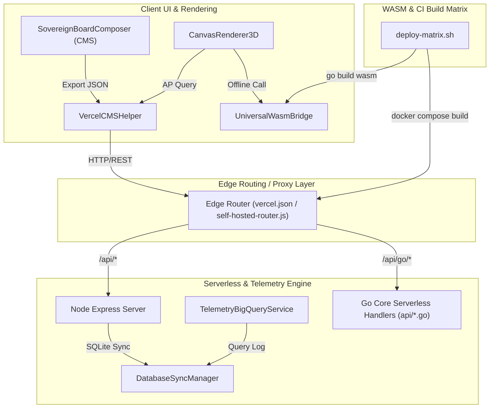

# Open-Source Foundation Developer Guide: End-to-End Integration Matrix

Welcome to the Dušan Game Open-Source Foundation portal. This guide synthesizes our modular subsystems, serverless deployment tracks, container environments, and technology bridges into a unified developer roadmap.

---

## 1. System Integration Map

The diagram below maps how our static UI layers, serverless API routers, analytical data sinks, and native Go engines interact across both cloud (Vercel) and self-hosted (Docker/EC2) runtimes:



---

## 2. Monorepo Subsystems & Reference Playbooks

To contribute to specific modules, follow the blueprints and playbooks we have established:

### Category A: Core Game Rules & Trajectories
*   **[Mulligan Phase & Gravity Well](file:///home/rhoddos_berger/Documents/Github/dusan-game/docs/MULLIGAN_AND_GRAVITY_WELL_DOCUMENTATION.md)**: Details state-machine transitions during cards mulligan, alongside exponential physics energy cost curves near gravity anomalies.
*   **[Eight-Directional Cartesian Trajectory](file:///home/rhoddos_berger/Documents/Github/dusan-game/docs/REPOSITORY_INTROSPECTION_AND_CORE_KNOWLEDGE.md)**: Explains the Slovak string directional parsing and translation of axial directions into Euclidean movement vectors on the 3D canvas.

### Category B: Interface Bridges & Adapters
*   **[Go Core TS Mediator](file:///home/rhoddos_berger/Documents/Github/dusan-game/packages/shared/src/core/GoCoreMediator.ts)**: Handles serialization and deserialization of the canvas grid while ensuring deterministic local JavaScript fallbacks are available if the Go service is unreachable.
*   **[Universal WASM Bridge](file:///home/rhoddos_berger/Documents/Github/dusan-game/packages/shared/src/core/UniversalWasmBridge.ts)**: Facilitates loading WebAssembly binaries compiled from Go, Rust, or C++ in worker threads.
*   **[Vercel CMS Helper](file:///home/rhoddos_berger/Documents/Github/dusan-game/packages/client/src/utils/VercelCMSHelper.js)**: Manages layout state synchronization and offline local storage retries.

### Category C: Deployment & Self-Hosting
*   **[Vercel Serverless Pipeline](file:///home/rhoddos_berger/Documents/Github/dusan-game/docs/VERCEL_DEPLOYMENT_AND_SERVERLESS_PIPELINE.md)**: Configures continuous integration deployment and serverless routes via the root `vercel.json` file.
*   **[Self-Hosted Edge Simulator](file:///home/rhoddos_berger/Documents/Github/dusan-game/docs/SELF_HOSTED_SERVERLESS_RUNTIME_SPEC.md)**: Documents running the edge router proxy daemon locally using `self-hosted-router.js`.
*   **[Docker & Jenkins Orchestration](file:///home/rhoddos_berger/Documents/Github/dusan-game/docs/DOCKER_JENKINS_SELF_HOSTED_ORCHESTRATION.md)**: Details multi-container orchestration using Docker Compose and automated Jenkins verification workflows.

---

## 3. Local Development Bootstrap (Yarn Workspaces)

To get started developing on the monorepo:
1.  **Clone & Restore**:
    ```bash
    git clone https://github.com/RhodosBerger/dusan-game.git
    cd dusan-game
    yarn install --frozen-lockfile
    ```
2.  **Execute Local Tests**:
    Verify the entire compilation state of engines and services:
    ```bash
    npx ts-node packages/server/src/testEngine.ts
    ```
3.  **Run Compilation Matrix**:
    Use the deployment matrix script to compile static and serverless targets locally:
    ```bash
    ./deploy-matrix.sh
    ```
